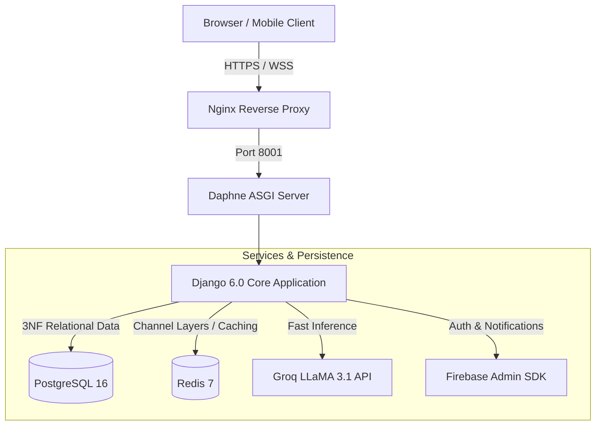

# ♻️ TrashPort — On-Demand Smart Waste Collection Platform

[](https://www.python.org/)
[](https://www.djangoproject.com/)
[](https://www.docker.com/)
[](https://github.com/astral-sh/uv)
[](https://github.com/features/actions)

**TrashPort** is an end-to-end, on-demand municipal waste collection, reverse logistics, and recyclables exchange platform. It seamlessly connects citizens with local collectors through intelligent dispatching, real-time GPS tracking, dynamic weight-based pricing, and an integrated AI support chatbot.

---

## 🚀 Key Features

### 👤 Citizen Portal
- **On-Demand Booking**: Schedule residential pickups for Dry Recyclables, Wet Waste, E-Waste, and Hazardous materials.
- **Interactive Mapping**: Pinpoint precise pickup coordinates with auto-reverse geocoding using Leaflet.js and OpenStreetMap.
- **Real-Time Tracking**: Live WebSocket tracking of assigned collection vehicles with dynamic arrival ETAs.
- **Green Rewards**: Earn wallet reward points redeemable across platform services.
- **Online Checkout & Invoices**: Integrated digital payment simulation with itemized receipts and PDF invoice generation.

### 🚛 Collector Dashboard
- **Proximity-Based Dispatch**: View and claim available pickups ranked by distance and estimated payout.
- **Simulated Aadhaar KYC**: Privacy-first collector identity verification using Verhoeff checksum validation and SHA-256 masked hashing.
- **On-Site Weight Verification**: Dynamic excess weight recalculation with automatic fee adjustments.
- **Turn-by-Turn Routing**: Integrated road navigation to citizen pickup destinations.
- **Wallet & Payouts**: Real-time earnings calculation (base rate + distance commission) with direct UPI withdrawal requests.

### 🛡️ Municipal Admin Console
- **Operations Dashboard**: Monitor real-time KPIs, active collector locations, and daily collection metrics.
- **Zone Management**: Define geographic operational service zones, boundaries, and coverage radii.
- **Category Pricing**: Configure base fees per kilogram, reward points, and excess weight multipliers.
- **Grievance Resolution**: Dedicated ticket management system for citizen complaints and feedback.

### 🤖 Groq LLM Assistant
- **Conversational Booking**: Natural language pickup scheduling, status checks, and FAQ resolution powered by Groq's high-speed LLaMA 3.1 inference engine.

---

## 🏗️ Architecture Overview



---

## 🛠️ Tech Stack

| Layer | Technology | Purpose |
| :--- | :--- | :--- |
| **Backend** | Python 3.13, Django 6.0 | Core application & business logic |
| **ASGI / Realtime** | Daphne, Django Channels 4 | WebSockets for live maps & chatbot |
| **Database** | PostgreSQL 16 (AWS RDS) | 3NF relational persistence |
| **Cache & Broker** | Redis 7 | Channel layers, dispatch state & caching |
| **Package Manager**| Astral `uv` | Ultra-fast dependency resolution |
| **Frontend** | HTML5, Vanilla CSS, JS, Bootstrap 5 | Modern, responsive UI |
| **Maps** | Leaflet.js, OpenStreetMap, OSRM | Geospatial mapping & road routing |
| **AI / NLP** | Groq Cloud (LLaMA 3.1-8B) | Contextual chat assistant |
| **DevOps** | Docker, Docker Compose, GitHub Actions | Multi-stage containerization & automated CI/CD |

---

## 📦 Quick Start with Docker (Recommended)

The easiest way to run the complete stack (Django + PostgreSQL + Redis) locally:

### 1. Clone the Repository
```bash
git clone https://github.com/albertcyriac04-lgtm/TrashPort.git
cd TrashPort
```

### 2. Configure Environment Variables
```bash
# Windows PowerShell
Copy-Item .env.example .env

# Linux / macOS
cp .env.example .env
```

### 3. Build & Run Containers
```bash
docker compose -f docker-compose.local.yml up --build
```
> The application will be live at **http://localhost:8001**

### 4. Initialize Database & Seed Demo Data
In a separate terminal:
```bash
# Run migrations
docker compose -f docker-compose.local.yml exec django python manage.py migrate

# Seed service zones and initial waste categories
docker compose -f docker-compose.local.yml exec django python scripts/seed_zones.py
docker compose -f docker-compose.local.yml exec django python scripts/seed_data.py

# Create an administrator superuser
docker compose -f docker-compose.local.yml exec django python manage.py createsuperuser
```

---

## 💻 Native Development Setup (with `uv`)

If you prefer running the Python virtual environment directly on your host:

### 1. Install `uv`
```bash
# Windows (PowerShell)
powershell -ExecutionPolicy ByPass -c "irm https://astral.sh/uv/install.ps1 | iex"

# macOS / Linux
curl -LsSf https://astral.sh/uv/install.sh | sh
```

### 2. Install Project Dependencies
```bash
uv sync
```

### 3. Start Redis & PostgreSQL
Ensure PostgreSQL (port `5432`) and Redis (port `6379`) are running on your system, or start them via Docker:
```bash
docker run -d -p 6379:6379 redis:7-alpine
```

### 4. Run Migrations & Start Development Server
```bash
uv run python manage.py migrate
uv run python scripts/seed_zones.py
uv run python manage.py runserver 0.0.0.0:8001
```

---

## 🧪 Automated Testing

TrashPort includes unit and integration tests covering authentication, dispatch algorithms, payment services, and scheduling:

```bash
# Run test suite
uv run pytest
```

---

## 🚢 Production Deployment (AWS EC2)

The repository includes an automated Continuous Deployment pipeline via **GitHub Actions** ([.github/workflows/deploy.yml](.github/workflows/deploy.yml)):

1. Configure **GitHub Repository Secrets**:
   - `EC2_HOST`: Public IP of your EC2 instance (e.g. `13.232.202.220`).
   - `EC2_USER`: `ubuntu`
   - `EC2_SSH_KEY`: Content of your AWS `.pem` private key.
2. Push your changes to the `main` branch:
   ```bash
   git push origin main
   ```
3. GitHub Actions connects to the EC2 server over SSH, pulls the update, rebuilds the Docker container, runs migrations, and collects static assets automatically.

---

## 📂 Project Structure

```text
TrashPort/
├── .github/workflows/      # CI test pipeline & automated EC2 deploy
├── config/                 # Project configuration & settings
│   ├── settings/           # base.py, local.py, production.py, test.py
│   ├── asgi.py             # ASGI entrypoint with WebSocket routing
│   ├── wsgi.py             # WSGI web server entrypoint
│   └── urls.py             # Root URL routing table
├── docs/                   # Technical architectural reports & diagrams
├── scripts/                # Database seeding & administrative utilities
├── trashport/              # Core Django applications
│   ├── core/               # Waste management, categories & geographic maps
│   ├── services/           # Chatbot, dispatch algorithms, payments & notifications
│   ├── users/              # Custom user models, Google OAuth & RBAC
│   ├── static/             # Stylesheets, JavaScript modules & images
│   └── templates/          # Jinja/Django HTML templates
├── Dockerfile              # Multi-stage container build
├── docker-compose.yml      # Production service orchestration
├── docker-compose.local.yml# Local development orchestration
├── pyproject.toml          # Project dependencies and tool configurations
└── uv.lock                 # Deterministic dependency lockfile
```

---

## 📜 License
This project is developed for academic evaluation and proprietary implementation. All rights reserved.
