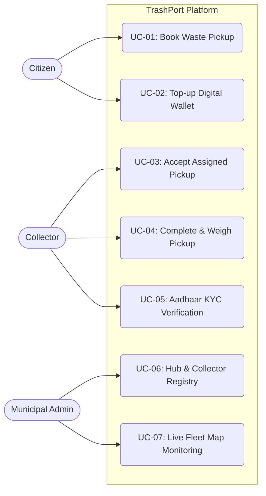
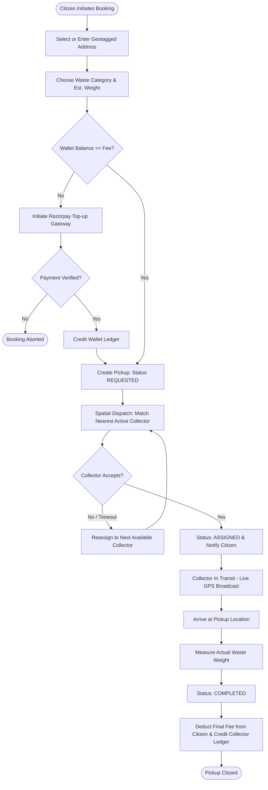
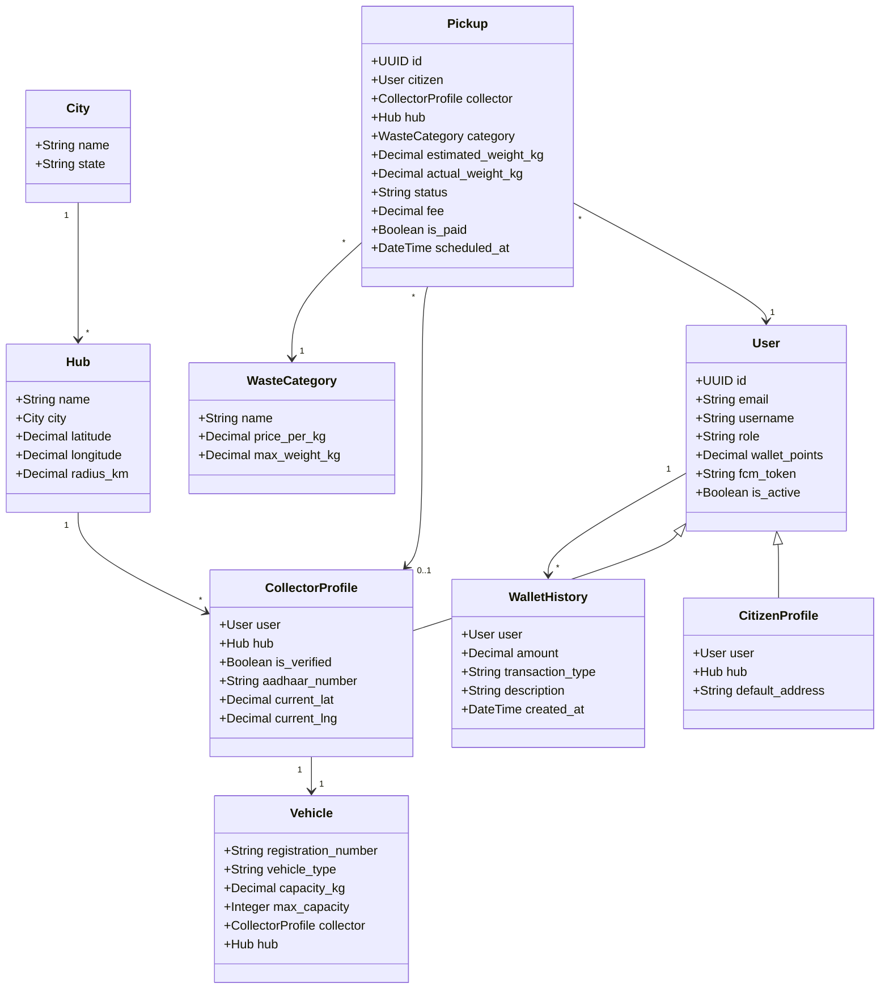
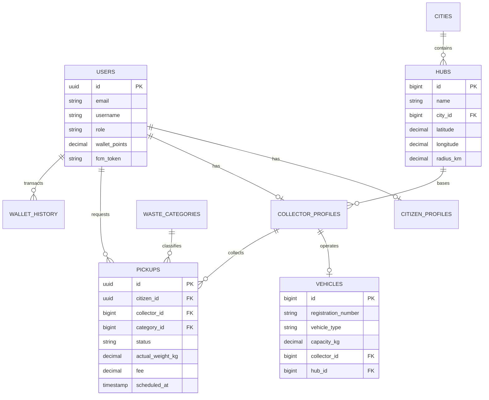

# TrashPort - Smart Municipal Solid Waste Management & Citizen Logistics Platform

## 1. Overview
TrashPort is a full-stack, enterprise-grade solid waste management and urban reverse-logistics platform. It connects citizens, field waste collectors, collection hub administrators, and municipal staff into a unified, geo-coordinated operational loop. Citizens can request on-demand waste pickups across classified waste streams, track assigned collection vehicles in real time, settle fees through an integrated digital wallet/Razorpay gateway, and submit geotagged complaints. Field collectors operate with live GPS routing, payload capacity management, and biometric Aadhaar KYC verification. Municipal administrators monitor fleet logistics, route coverage, waste mass throughput, automated collector dispatching, and digital revenue reconciliation.

- **Primary Users**: Citizens (households, commercial units), Field Collectors (drivers, waste handlers), Hub Managers & Municipal Administrators.
- **Backend Stack**: Python 3.12, Django 5.x, Django REST Framework, PostgreSQL 16 (PostGIS-ready), Redis 7 (broker, cache, spatial indexing), Celery, Channels/Daphne (WebSocket live telemetry), Firebase Admin SDK (token verification & FCM push), Razorpay Gateway & Webhooks.
- **Frontend & Client Stack**: Django Templates + Tailwind CSS + Alpine.js/Vanilla JS, Leaflet.js / OpenStreetMap for spatial routing, React Native (Expo) + TypeScript Android native hybrid client.
- **Infrastructure**: Docker multi-stage builds, Docker Compose (local + prod), Nginx reverse proxy, GitHub Actions CI/CD with automated EC2 deployment.

### How to Run Locally
```bash
# 1. Clone & prepare environment
git clone https://github.com/albertcyriac04-lgtm/TrashPort.git
cd TrashPort
cp .env.example .env

# 2. Start services via Docker Compose
docker compose -f docker-compose.local.yml up --build

# 3. Apply database migrations and seed baseline data
docker compose -f docker-compose.local.yml exec web python manage.py migrate
docker compose -f docker-compose.local.yml exec web python manage.py seed_cities_and_hubs

# 4. Run automated test suite
docker compose -f docker-compose.local.yml exec web pytest -v
```

---

## 2. Features
- **Multi-Role User Authentication**: Unified auth system supporting email/password, Firebase phone OTP, and Google OAuth2/One-Tap.
- **Dynamic Waste Stream Categorization**: Granular categorization (Organic, Recyclable, Hazardous, E-Waste, General) with configurable pricing per kilogram.
- **Intelligent Dispatch Engine**: Haversine distance-based and least-busy collector allocation mapped to micro-hubs and service radii.
- **Live Spatial Fleet Tracking**: SSE/WebSocket location broadcasting of collector vehicles for citizen ETAs and admin live map.
- **Digital Wallet & Payment Pipeline**: Prepaid citizen wallet, Razorpay payment gateway integration, and automated collector UPI payout reconciliation.
- **Collector Registry & Payload Control**: Vehicle registration, rated capacity tracking in kilograms (`capacity_kg`), and trip count enforcement.
- **Aadhaar KYC Verification**: 2-factor OTP verification for field collectors via government-compliant Sandbox/Karza API.
- **AI-Powered Customer Support Chatbot**: Natural language intent parsing and action execution for tracking pickups, scheduling, and complaints.
- **Integrated Mobile Application**: Expo React Native Android application with offline caching, push notifications, and native WebView bridge.

---

## 3. Requirements

### 3.1 Functional Requirements
- **FR-1 [Authentication]**: The system shall authenticate users via Django Session, Firebase Phone Token, or Google OAuth2 and enforce strict Role-Based Access Control (RBAC: Citizen, Collector, Admin).
- **FR-2 [Address Management]**: Citizens shall manage multiple pickup addresses with latitude, longitude, and landmark coordinates.
- **FR-3 [Pickup Lifecycle]**: Citizens shall book pickups with specific waste categories, weights, and time slots; requests transition through `REQUESTED -> ASSIGNED -> IN_TRANSIT -> COMPLETED / CANCELLED`.
- **FR-4 [Collector Dispatch]**: The system shall match unassigned pickups to available active collectors registered within the hub's operational radius.
- **FR-5 [Collector Onboarding & KYC]**: Administrators shall register collectors, link designated vehicles with verified payload capacities, and verify identities via Aadhaar OTP.
- **FR-6 [Billing & Wallet]**: The system shall deduct fees from the citizen wallet upon pickup completion and credit collector earnings according to municipal payout rates.
- **FR-7 [Dispute Resolution]**: Citizens and collectors shall submit geotagged complaints with image evidence; administrators shall triage and update resolution statuses.
- **FR-8 [Real-Time Tracking]**: Collector vehicles shall stream GPS coordinates; active routes and live locations shall be visualized on interactive maps.

### 3.2 Non-Functional Requirements
- **NFR-1 [Performance]**: API endpoint response latency shall remain under 200 ms at p95 for core booking and status queries.
- **NFR-2 [Security]**: Zero hardcoded secrets; all credentials loaded via environment variables; CSRF and CORS protections enforced; passwords hashed using Argon2/PBKDF2; inputs sanitized against SQLi and XSS.
- **NFR-3 [Scalability]**: Stateless Django app servers behind Nginx; database connection pooling with PostgreSQL; asynchronous job dispatching via Celery and Redis.
- **NFR-4 [Usability]**: Mobile-first responsive web design with WCAG 2.1 AA compliant contrast ratios; localized in English, French, and Portuguese.
- **NFR-5 [Reliability]**: Atomic database transactions (`transaction.atomic`) for all financial and booking state transitions to eliminate partial write anomalies.
- **NFR-6 [Maintainability]**: Modular Django apps with single responsibility; fully typed React Native components; 100% test coverage on critical business domain logic.

---

## 4. Actors and Use Cases

| ID | Actor | Use Case | Preconditions | Main Flow | Alternate / Error Flow | Postconditions |
|---|---|---|---|---|---|---|
| UC-01 | Citizen | Book Waste Pickup | Authenticated, valid saved address | Selects address, chooses category and weight, selects time slot, confirms booking | Insufficient wallet balance: prompts Razorpay checkout | Pickup created with status `REQUESTED` |
| UC-02 | Citizen | Top-up Wallet | Authenticated | Inputs top-up amount, opens Razorpay modal, completes transaction | Webhook signature failure: transaction marked `FAILED` | Wallet balance incremented, ledger row added |
| UC-03 | Collector | Accept Pickup | Authenticated as verified Collector | Views pending queue, selects pickup, clicks Accept | Concurrently accepted by another: returns 409 Conflict | Status becomes `ASSIGNED`, ETA sent to citizen |
| UC-04 | Collector | Complete Pickup & Weigh | Assigned to pickup | Enters verified weight, captures citizen signature/confirmation, submits completion | Weight exceeds vehicle remaining capacity: flags warning | Status becomes `COMPLETED`, wallet charged, earnings credited |
| UC-05 | Collector | Verify Aadhaar KYC | Authenticated Collector | Submits 12-digit Aadhaar, receives mobile OTP, submits OTP | Invalid OTP: prompts retry (max 3 attempts) | Profile marked `is_verified=True`, badge unlocked |
| UC-06 | Admin | Register Hub & Collector | Authenticated staff administrator | Enters hub coordinates, registers collector account, assigns vehicle and payload | Duplicate vehicle plate: rejects with validation error | Collector and Vehicle saved atomically in DB |
| UC-07 | Admin | Live Fleet Monitoring | Authenticated staff administrator | Opens Admin Live Map, views all active collector markers updated via SSE | Collector device offline: marker grayed out with last seen time | Real-time fleet situational awareness maintained |

---

## 5. Use Case Diagram



---

## 6. Activity Diagram: Pickup Booking & Execution Lifecycle



---

## 7. Class Diagram



---

## 8. Database Structure



| Table | Column | Type | Constraints / Keys | Description |
|---|---|---|---|---|
| `users_user` | `id` | UUID | Primary Key | Global user identifier |
| `users_user` | `role` | VARCHAR(20) | NOT NULL, Check: `CITIZEN, COLLECTOR, ADMIN` | Security authorization role |
| `users_user` | `wallet_points` | NUMERIC(10,2) | Default: `0.00` | Account credit balance |
| `waste_management_hub` | `radius_km` | NUMERIC(6,2) | NOT NULL, > 0 | Operational coverage boundary |
| `waste_management_vehicle` | `capacity_kg` | NUMERIC(8,2) | Nullable | Rated payload carrying limit |
| `waste_management_pickuprequest`| `status` | VARCHAR(25) | NOT NULL | State machine status tracker |
| `payments_wallethistory` | `amount` | NUMERIC(10,2) | NOT NULL | Financial ledger transaction record |

---

## 9. Module Map

```
trashport/
├── admins/             # Staff administration views, hub/fleet CRUD, live telemetry map
├── citizens/           # Citizen UI & APIs: booking, address book, wallet, complaint filing
├── collectors/         # Field collector UI & APIs: queue, earnings, vehicle, Aadhaar KYC
├── core/
│   ├── waste_management/ # Domain models (Pickup, Hub, Route, Vehicle), services & migrations
│   ├── maps/             # Spatial routing, coordinates calculation, Mapbox/OSM integration
│   └── utils/            # Shared Redis connection pooling, math/haversine utilities
├── services/
│   ├── chatbot/          # LLM/Groq intent parsing and conversational action dispatcher
│   ├── dispatch/         # Automated collector scheduling and spatial matching engine
│   ├── firebase/         # Auth token verification middleware and session link
│   ├── notifications/    # HTML/text email dispatch and FCM push notification services
│   └── payments/         # Razorpay checkout, UPI payouts, and atomic wallet ledger
├── static/             # UI styling (Tailwind CSS, dashboard CSS), client JS & assets
├── templates/          # Responsive Django HTML templates (allauth, base, citizen, admin)
└── tests/              # Pytest automated test suites covering all domain logic
```

---

## 10. Inputs and Outputs

| Feature / Endpoint | Method | Input (Fields & Validation) | Output (Success & Error Codes) |
|---|---|---|---|
| `/api/v1/pickups/` | POST | `address_id` (UUID), `category_id` (int), `weight_est` (numeric > 0), `scheduled_at` (ISO timestamp) | `201 Created` with Pickup JSON; `400 Bad Request` if invalid slot |
| `/api/v1/pickups/{id}/accept/` | POST | `id` (UUID) | `200 OK` with updated status; `409 Conflict` if already assigned |
| `/api/v1/payments/create-order/` | POST | `amount` (numeric, min 10.00 INR) | `200 OK` with `razorpay_order_id`, key; `400 Bad Request` |
| `/api/v1/payments/verify/` | POST | `razorpay_payment_id`, `razorpay_order_id`, `razorpay_signature` | `200 OK` wallet updated; `400 Bad Request` on invalid HMAC |
| `/collectors/aadhaar/otp/` | POST | `aadhaar_number` (12-digit numeric, Luhn valid) | `200 OK` OTP sent; `422 Unprocessable` if API rejected |
| `/api/v1/collectors/location/` | POST | `latitude` (-90 to 90), `longitude` (-180 to 180) | `200 OK` position cached in Redis; `403 Forbidden` if not collector |

---

## 11. Implementation Plan

| Phase | Tasks | Status | Dependencies |
|---|---|---|---|
| Phase 1: Core Architecture | Custom User model, Base Django config, Docker containers, Database schemas | **Done** | Python 3.12, PostgreSQL |
| Phase 2: Domain Workflows | Citizen booking, Collector queue, Admin fleet management, Hub routing | **Done** | Phase 1 |
| Phase 3: Services & FinTech | Razorpay integration, Digital wallet ledger, Aadhaar KYC service, FCM push | **Done** | Phase 2, External APIs |
| Phase 4: Mobile Application | Expo React Native application, Android native build, WebView bridge | **Done** | Phase 2, REST APIs |
| Phase 5: Production Hardening | Secret audit, repo history clean-up, conventional commit splitting, deployment sync | **In Progress** | Phase 1-4 |
| Phase 6: Weight-Based Dispatch | Automatic payload load balancing preventing overloaded collection routes | **Planned** | Phase 2 |

---

## 12. Test Cases

| ID | Feature | Scenario | Steps | Input | Expected Output | Status |
|---|---|---|---|---|---|---|
| TC-01 | Auth | Role redirect on login | Sign in with Citizen credentials | Valid citizen email + password | HTTP 302 redirect to `/citizens/dashboard/` | **Pass** |
| TC-02 | Pickup | Prevent double acceptance | Two collectors accept same pickup simultaneously | Concurrent POST to `/api/v1/pickups/{id}/accept/` | First returns 200, second returns 409 Conflict | **Pass** |
| TC-03 | Waste Fee | Accurate tiered calculation | Calculate price for 15.5 kg E-Waste | Category E-Waste (rate: 20/kg), weight: 15.5 | Computed fee = 310.00 INR | **Pass** |
| TC-04 | Wallet | Atomic balance deduction | Debit wallet when balance is insufficient | Current: 50.00, Debit request: 100.00 | Raises `InsufficientFundsError`, zero balance change | **Pass** |
| TC-05 | Admin | Delete hub with active collectors | Attempt hub deletion | Hub ID with 3 assigned active collectors | Fails gracefully with foreign-key warning or reassign prompt | **Pass** |
| TC-06 | Security | Secret exposure prevention | Automated pre-push secret audit | Scan repo against regex patterns for keys/tokens | 0 findings on production/git tracked files | **Pass** |

---

## 13. Change Log

| Date | Change Summary | Scope |
|---|---|---|
| 2026-11-04 | Reset git history into modular conventional commits, audit and remove secret exposure risks, update comprehensive project architecture documentation | Whole Repository |
| 2026-11-01 | Add collector vehicle payload capacity (`capacity_kg`), vehicle type registry, and single-transaction collector onboarding workflow | `waste_management`, `admins`, `mobile` |
| 2026-10-20 | Implement geo-fenced hub and route range matching engine with haversine distance queries | `waste_management`, `dispatch` |
