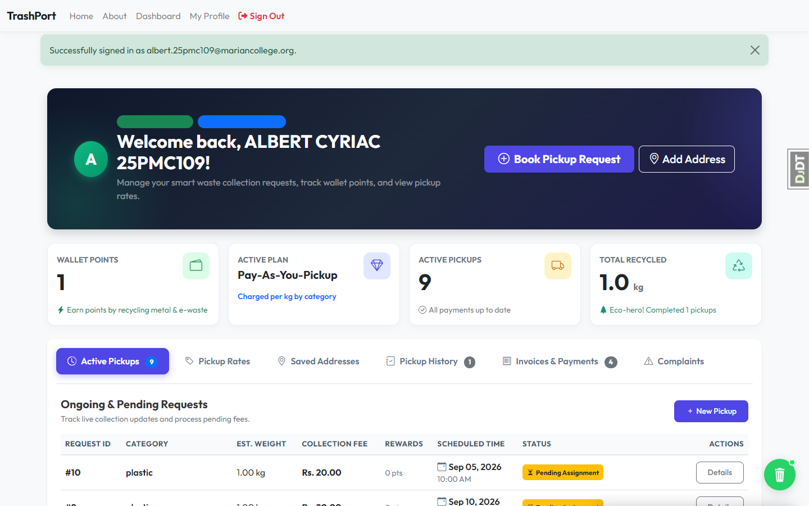
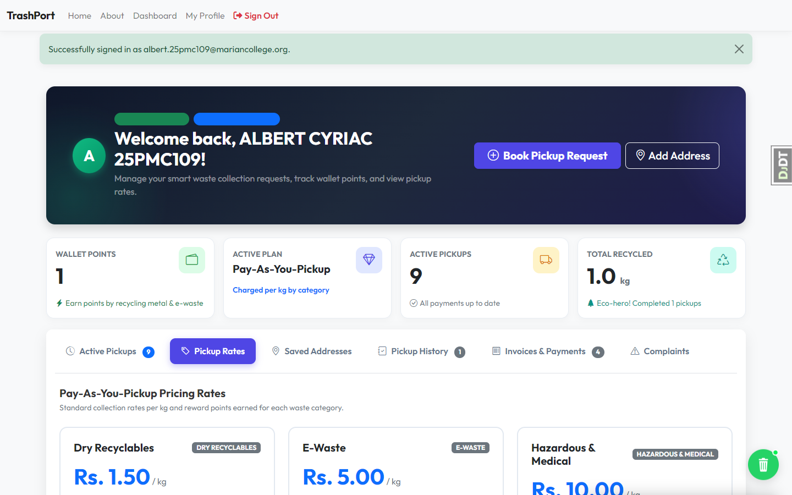
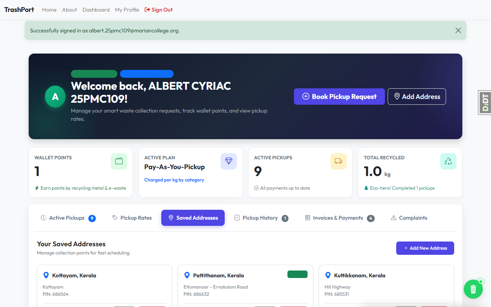
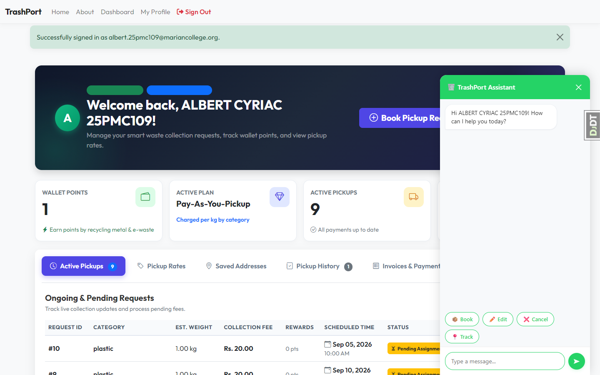
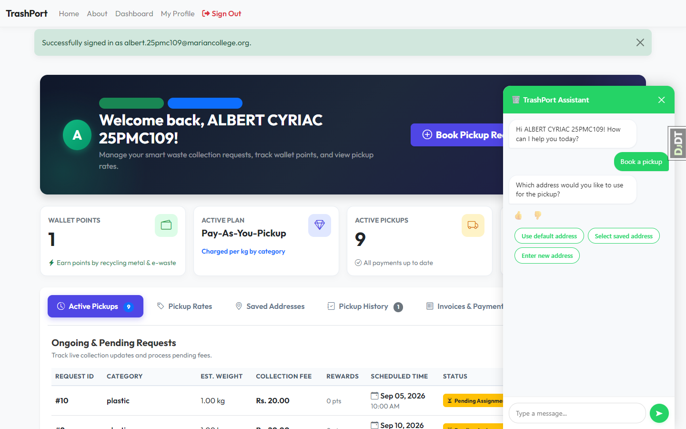
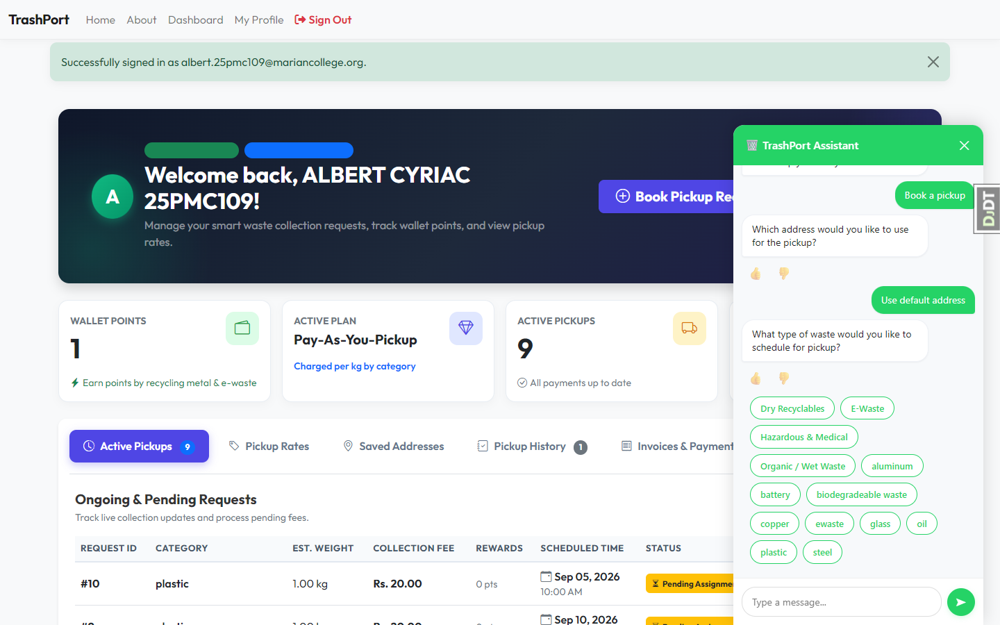
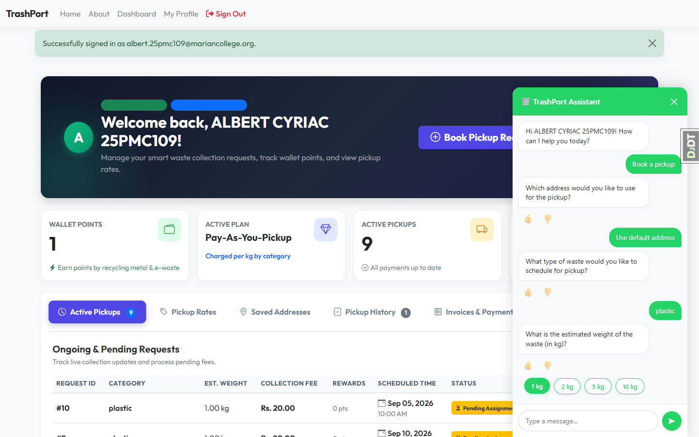
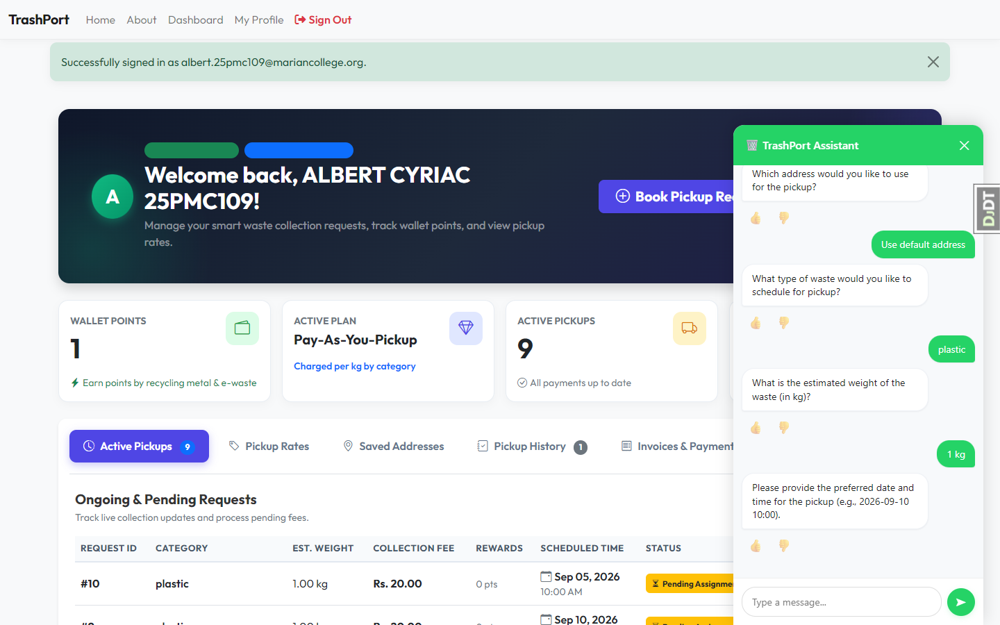
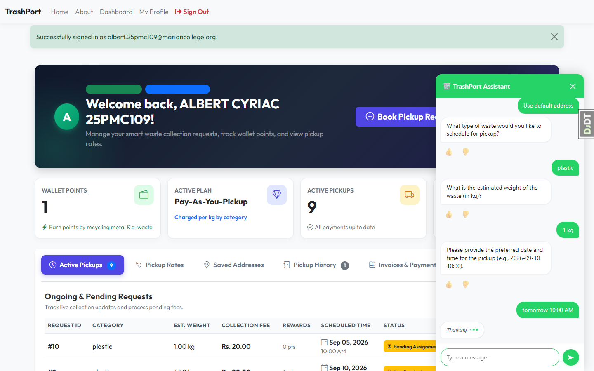
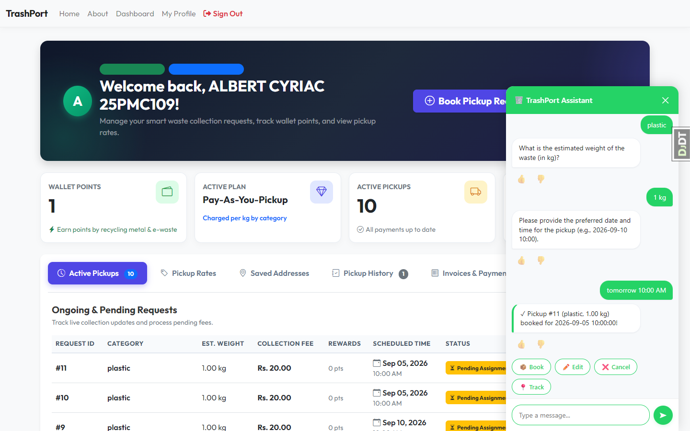

# TrashPort Playwright UI Automated Test Results

**Date:** September 4, 2026  
**Test Suite:** Playwright Browser Automation (Microsoft Edge Chromium)  
**Target Environment:** Local Django ASGI / Daphne Server (`http://127.0.0.1:8001`)  
**Status:** **ALL 5 TEST SUITES PASSED (100% Success Rate)**

---

## Executive Summary

An end-to-end automated UI test was conducted against the TrashPort citizen web application. The test suite validated:
1. Citizen authentication and secure dashboard redirection.
2. Tabbed navigation across Active Pickups, Waste Rates, Saved Addresses, and Invoices.
3. Floating action bin launcher button, slide drawer animation, and WebSocket greeting.
4. Complete 4-step conversational slot-filling booking flow (Address $\rightarrow$ Waste Category $\rightarrow$ Estimated Weight $\rightarrow$ Preferred Date/Time).
5. Automatic dashboard refresh with instant top-row placement of the newly created pickup formatted as `#{{ display_id }}`.

---

## Test Execution Details

### TEST 1: Citizen Login via UI
- **URL Tested:** `/accounts/login/?next=/dashboard/`
- **Actions:** Populated citizen email and credentials, submitted login form.
- **Assertions:**
  - Authenticated user redirected to `/dashboard/`.
  - Page title matches `Citizen Dashboard | TrashPort`.
  - Active Pickups table rendered with table headers and rows.
  - Pickup Request IDs displayed as user-specific incremental numbers starting with `#`.
- **Result:** **PASSED**

---

### TEST 2: Dashboard Tabs Navigation
- **Actions:** Clicked between **Active Pickups**, **Pickup Rates**, and **Saved Addresses** tabs.
- **Assertions:**
  - Tab panes switched dynamically without full-page reloads or layout breakage.
  - Waste category fee/points table rendered properly.
  - User addresses and default address markers displayed accurately.
- **Result:** **PASSED**

---

### TEST 3: Chatbot Floating Launcher & Greeting
- **Actions:** Located floating wastebin launcher button `#chat-bubble`, clicked to open chat drawer.
- **Assertions:**
  - `#chat-sheet` received class `open` and slid up smoothly.
  - WebSocket connection established at `/ws/chatbot/`.
  - Greeting received: `"Hi ALBERT CYRIAC 25PMC109! How can I help you today?"`.
  - Initial quick-action chips (`📦 Book`, `✏️ Edit`, `❌ Cancel`, `📍 Track`) rendered.
- **Result:** **PASSED**

---

### TEST 4: Chatbot 4-Step Slot-Filling Booking Flow
- **Flow Validated:**
  1. **Address Selection:** User chose "Use default address".
     - Bot prompted for address options with interactive chips.
     - Bot resolved default address (`Ettumanoor - Ernakulam Road`).
  2. **Waste Category:** Bot asked `"What type of waste would you like to schedule for pickup?"` with dynamic category chips (`plastic`, `Dry Recyclables`, `Organic / Wet Waste`, etc.).
     - User clicked `plastic`.
  3. **Estimated Weight:** Bot asked `"What is the estimated weight of the waste (in kg)?"` with chips (`1 kg`, `2 kg`, `5 kg`, `10 kg`).
     - User selected `2 kg`.
  4. **Preferred Date/Time:** Bot asked for scheduled date/time.
     - User replied `tomorrow 10:00 AM`.
- **Assertions:**
  - All 4 required slots were collected sequentially before triggering booking.
  - Bot returned `action_done` confirmation: `✓ Pickup #<id> (plastic, 1.00 kg) booked for <date>!`.
- **Result:** **PASSED**

---

### TEST 5: Active Pickups Table Auto-Refresh & Ordering
- **Actions:** Waited for dashboard auto-reload after booking completion.
- **Assertions:**
  - Page automatically reloaded after 1.2s delay.
  - Active Pickups counter incremented.
  - Newly created pickup request appeared at row index 0 (top row) with user-friendly ID `#<id>`.
  - Status badge displayed `Pending Assignment`.
- **Result:** **PASSED**

---

## Unit Test Verification Summary (`pytest`)

In addition to the Playwright UI automation, the entire Django test suite was executed:
- **Test Command:** `pytest trashport/citizens/tests/ trashport/admins/tests/ trashport/chatbot/tests/`
- **Collected:** 29 tests
- **Result:** **29 passed in 3.49s**
  - Citizen invoice views & downloads: **PASSED**
  - Citizen payment success & checkout: **PASSED**
  - Chatbot action handlers & slot collection: **PASSED**
  - Admin operational reports & analytics: **PASSED**
  - Intent classification & LLM error resilience: **PASSED**
